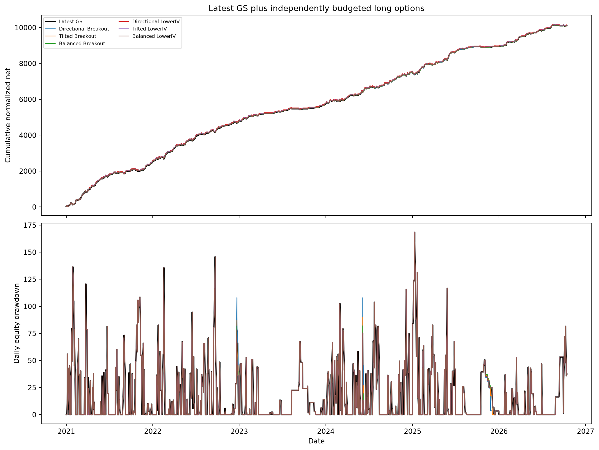
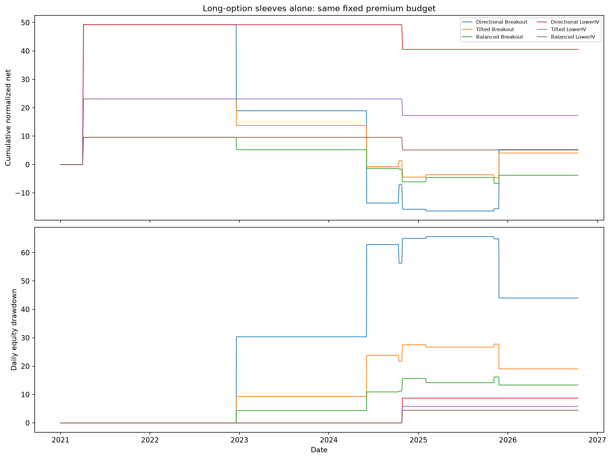

# Parallel long-option complement: fixed screen

- Fixed six-policy directional long-option screen; parameters were specified before new strategy PnL; no model fitting or historical winner adoption.
- Parallel sleeve authorized by owner. Additional premium budget is additional capital; no equal-capital or free-hedge claim.
- 100 normalized premium units per active position, determined at entry; fractional continuous quantities, not executable lot-rounded orders.
- Only second/minute data available in sampled files; source dates1900 are time placeholders; decision uses past availability, no backward fills.
- Buy at ask+1bp, sell at bid-1bp; fresh synchronized source-second fills with a decision delay. Multi-leg atomicity/capacity and source provenance remain modeled.
- Additional round-trip drag1 normalized unit per leg/standard25000-U quantity; double-drag stress included. This is not a verified actual statutory/broker fee schedule.
- Stop30% of premium, delayed fill may overshoot; long gross loss bounded by paid premium. No futures neutralization.
- Latest GS is from the matched fresh engine replay; it retains legacy LUT, fill and backfill limitations, unlike the new sleeve execution model.
- Combined DD is calculated from the combined daily PnL; strategy DDs are not added. DD excludes intraday MtM.
- GS losing-day/decile attribution is descriptive ex-post analysis, never a signal. All-calendar-day correlation includes zero/no-trade days.
- Same-contract offset is diagnostic; buying existing GS shorts can reduce net exposure without creating independent return alpha.
- Earlier research used these years; this screen is not an untouched holdout. No neural model, parameter optimization or alpha validation is claimed.
- Zero-error complete histories and exact serial/pool pilot parity are required before reporting.
- 11 pre-entry admission failures independently audited as ineligible; raw exceptions preserved, all dates retained. No execution/exit failures may be converted to zero.

| Policy | Net | Maximum DD | Worst day | Active days | Entries |
|---|---:|---:|---:|---:|---:|
| Latest GS | 10,109.38 | 168.42 | -78.55 | 794 | 794 |
| Directional Breakout | 5.27 | 65.63 | -32.50 | 8 | 8 |
| Tilted Breakout | 4.06 | 27.75 | -14.50 | 8 | 8 |
| Balanced Breakout | -3.77 | 16.19 | -6.56 | 8 | 8 |
| Directional LowerIV | 40.55 | 8.71 | -8.71 | 2 | 2 |
| Tilted LowerIV | 17.27 | 5.83 | -5.83 | 2 | 2 |
| Balanced LowerIV | 5.14 | 4.44 | -4.44 | 2 | 2 |
| GS + Directional Breakout | 10,114.65 | 168.42 | -78.55 | 798 | 802 |
| GS + Tilted Breakout | 10,113.44 | 168.42 | -78.55 | 798 | 802 |
| GS + Balanced Breakout | 10,105.61 | 168.42 | -78.55 | 798 | 802 |
| GS + Directional LowerIV | 10,149.93 | 168.42 | -78.55 | 794 | 796 |
| GS + Tilted LowerIV | 10,126.65 | 168.42 | -78.55 | 794 | 796 |
| GS + Balanced LowerIV | 10,114.51 | 168.42 | -78.55 | 794 | 796 |

Total long entries across the six policy books: 30, on only 8 distinct dates. Trades shared by policy variants are not independent observations. Every fixed policy is reported; none is adopted from a historical maximum.
Report the participation count with PnL and correlation: sparse trading alone does not establish a reliable directional or diversification edge.

None of the six combined paths reduced maximum daily drawdown below latest GS alone. No complementary policy is validated or adopted by this screen.

