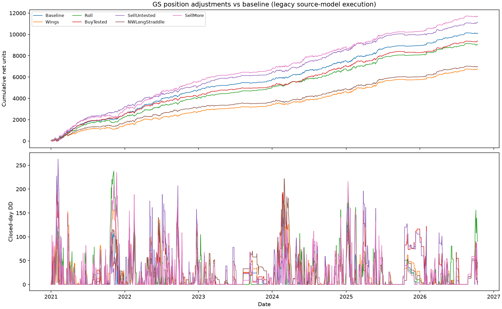

# GS position adjustments instead of stopping out

- Fixed position adjustments instead of stopping out, triggered by the first confirmed 4.24 regime signal; one per CW trade.
- Base trade, entries, size1, hedging and exits unchanged; added legs close at the base exit second. Roll replaces the base trade from t*.
- Added legs priced from raw tick quotes: buy at ask, sell at bid, 2-5 s after the decision; fee 0.25 per unit round trip (event x1/3).
- Added legs are not delta-hedged; Wings/BuyTested/NWLongStraddle add long options; SellUntested/SellMore add risk up to 1.5x per side.
- Retrospective fixed-candidate comparison over already-researched years: no winner selected, nothing adopted.
- Intraday DD is the 4.24 source-model mark proxy plus added legs marked at liquidation side; not executable account DD.
- NW trades and no-trade days unchanged in every candidate. Units: normalized additive (points x 25000 / entry underlying).
- Status not_applicable = candidate regime rule did not match the trigger; no_entry_quote / no_trigger / no_roll_entry = baseline kept.
- Verification: PASS_ACCOUNTING_SPEC_DEVIATIONS; accounting reconciles, but declared strike-at-fill specification deviations are retained. This study is not a validated implementation of its intended execution rule.
- Independent verification is quote/accounting reconciliation only, not causal execution certification. See GS_ADJUSTMENT_AUDIT_NOTES.md.
- Added-leg strike selection uses a post-trigger underlying observation; quotes do not check displayed quantity/crossing; five exits use up-to60second stale quotes.
- Added-leg cash is posted at base exit even if its quoted close is up to5seconds later. Roll uses a different legacy timing convention.
- The double-fee column stresses added option-leg model fees only, not all GS costs or roll execution costs; the1.5x short-unit cap is not a portfolio Greek/margin/currency-risk cap.

| Policy | Net | Daily DD | Intraday DD | Adjusted trades | Adjustment PnL |
|---|---:|---:|---:|---:|---:|
| Baseline | 10109.38 | 168.42 | 179.00 | 0 | 0.00 |
| Wings | 6749.97 | 167.08 | 230.99 | 641 | -3359.41 |
| Roll | 9054.60 | 237.98 | 272.85 | 656 | -1054.78 |
| BuyTested | 9377.12 | 197.93 | 224.09 | 340 | -732.26 |
| SellUntested | 11139.90 | 263.03 | 314.26 | 340 | 1030.52 |
| NWLongStraddle | 6975.34 | 221.85 | 298.61 | 648 | -3134.04 |
| SellMore | 11702.69 | 235.00 | 263.13 | 316 | 1593.31 |

No adjustment is adopted from this retrospective comparison.

