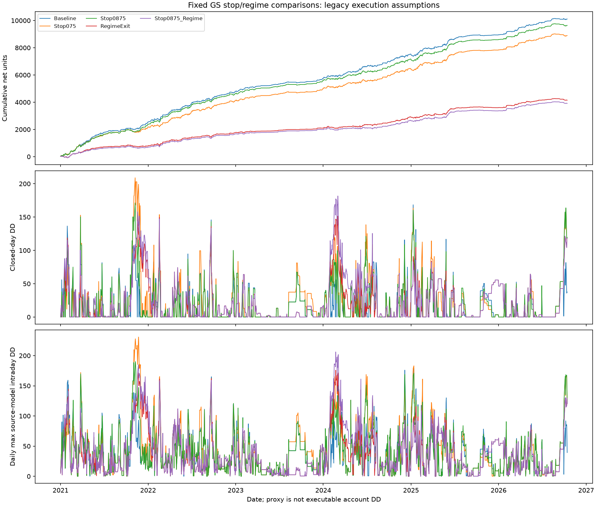

# GS intraday reconstruction and fixed stop comparisons

- Fixed CW stop/regime overlays on unchanged selected latest-GS trades; no size changes or new entries.
- Retrospective fixed-candidate comparison, no model fitted or threshold winner selected. Prior research already examined these years.
- Intraday DD is a SOURCE-MODEL mark proxy: legacy future option/futures averages and backfills remain; not certified executable account DD.
- CW hedges are second-based; NW retains its separate minute hedge/mark execution convention. NW unchanged by every overlay.
- Source_exit_cash_minus_trigger_mark isolates source mark/averaged-exit differences after like-for-like fees; it is not measured exchange slippage.
- Every early exit uses current source exit credit/debit and hedge PnL/cost prefix. Later hedge cash flows are discarded; daily PnL is never clipped.
- Raw Fut_position is the native hedge position before a hypothetical close. Close_net liquidates it under source assumptions; the overlay is flat thereafter. No extra close fees beyond the source model are invented.
- All1430 original dates retained, including Diwali/Muhurat. Entries and LUT penalties unchanged, including09:16.
- Full second source-model paths are in paths/*.parquet. Baseline_checkpoints sheet samples minute checks/hedges/extrema and is not the full intraday path.
- Source_model_day_max_DD carries prior intraday peaks across days. Period statistics reset within each reported period; these are not added.
- Episode duration includes flat cash observations before entry/after exit and at23:59:59; these are accounting marks, not invented market quotes.
- PnL and DD are normalized additive units, not currency or percentage account returns. No account capital is invented.
- Nonfinite reconstructed marks, trace failures and PnL mismatches block reporting. Legacy fills can conceal missing/stale source quotes; this is not quote-quality certification. Causal-execution replay and forward paper evidence remain necessary.

| Policy | Net | Daily DD | Source-model intraday DD | Changed exits |
|---|---:|---:|---:|---:|
| Baseline | 10109.38 | 168.42 | 179.00 | 0 |
| Stop075 | 8896.47 | 208.93 | 230.80 | 172 |
| Stop0875 | 9641.42 | 171.22 | 190.16 | 106 |
| RegimeExit | 4147.05 | 151.35 | 175.86 | 656 |
| Stop0875_Regime | 3912.07 | 181.61 | 206.12 | 677 |

No policy is adopted or called an optimal stop from this retrospective comparison.

