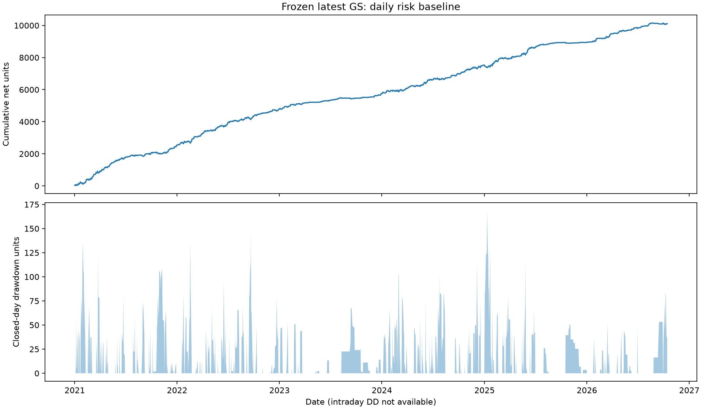

# GS stop and regime risk: measured daily baseline

This is the frozen latest-GS daily baseline, not an optimized stop/model result.
- Dates: 1430; traded dates: 794.
- Net normalized PnL: 10109.38; maximum closed-day DD: 168.42.
- Worst traded day: -78.55; mean of worst40 traded days: -46.78.
- Intraday DD and whole-trade MAE are unavailable from daily checkpoints and are not estimated here.
- Net loss beyond the gross CW trigger is a diagnostic including fees and other exits; it is not a measured trigger-to-fill overshoot.
- Global DD carries the equity peak across year boundaries. Period-reset and rolling-window DD are separately labeled.
- No account capital is assumed; these are additive normalized units, not currency returns or percentage DD.
- Next execution gates, event labels, regime controls and chronological comparison are defined in research/GS_STOP_REGIME_RISK_SPEC.md.

