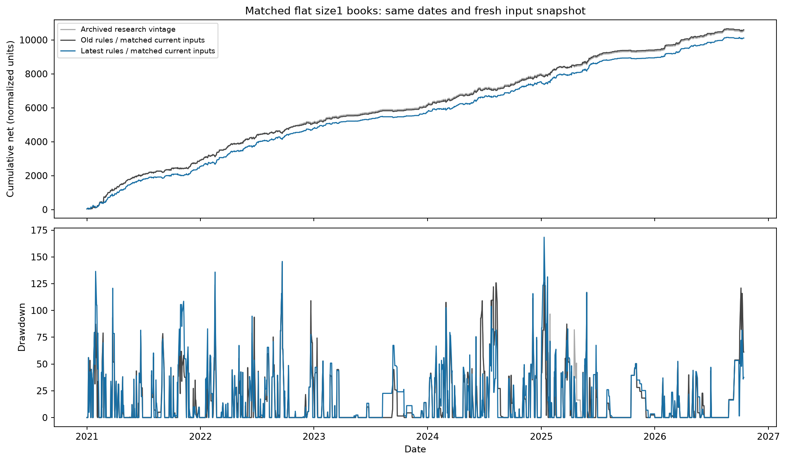
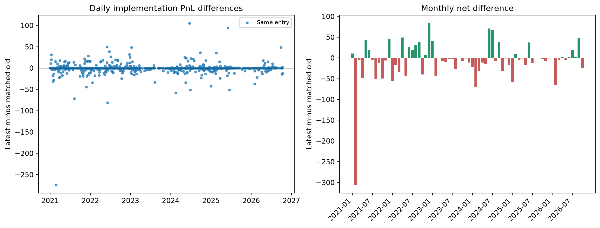

# Latest GammaShort logic: matched replay

- Same1430 archived dates, identical frozen current daily/event inputs and latest table files in both fresh books.
- Archived reference retains its original input vintage; use New minus Old matched for implementation comparison.
- Flat multiplier1 throughout. This is not a new sizing fit or an old-PnL rescaling.
- Every date is included, including zero-PnL/no-trade dates. Maximum DD includes initial zero equity; per-period DD resets.
- DD is the closed-day equity drawdown, not a tick-by-tick intraday mark-to-market drawdown. Values are normalized backtest PnL units.
- Source option30-second/futures3-second averages and backfills remain; this is a version comparison, not a certification of causal fills.
- CW gross minus explicit costs equals net. NW source labels its already-net result as gross; NW cost columns are not a claim of zero execution cost.
- Same-entry cohort matches date, expiry leg, entry minute and strike. Cell/exit differences remain visible.
- Pruned versus full new source and native-loader parity passed the six-day pilot. Per-date errors must be zero.
- The old fixed-time diagnostic simulations are retained: removing their rows could alter DTE fallback on a no-production-row day.
- Source_settings lists literal uppercase assignments only; differently named or computed settings need the source and Rule_changes.
- Neither live code nor shared inputs were changed. Source snapshots, fingerprints and generated adapter are retained.
- Empty-expiry adapter failures were re-run through both original native loaders; both returned no trade. Original adapter exceptions and fallback source are preserved.

| Book | Net | Maximum DD | Worst day | CW trades | NW trades |
|---|---:|---:|---:|---:|---:|
| Archived research vintage | 10,522.04 | 144.37 | -61.28 | 720 | 79 |
| Old rules / matched current inputs | 10,594.58 | 144.37 | -61.28 | 721 | 73 |
| Latest rules / matched current inputs | 10,109.38 | 168.42 | -78.55 | 721 | 73 |

Latest minus freshly replayed old: net -485.203111; MDD +24.058370.
Entry status: {'Same entry': 794, 'No trade both': 636}. Same-entry exits changed: 169.
Earlier sizing results remain studies on the old book. They must not be described as new-logic sizing performance.

