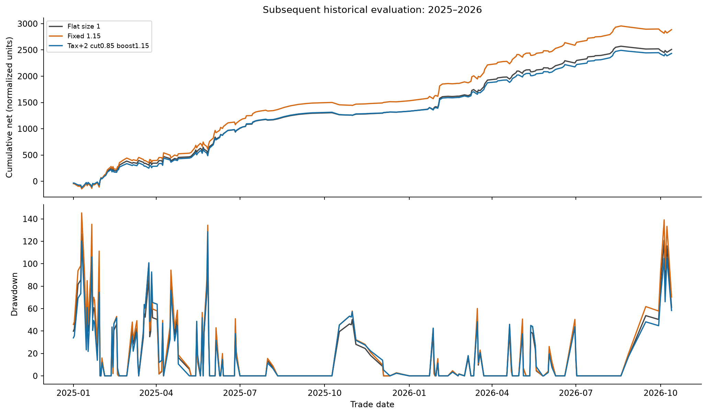
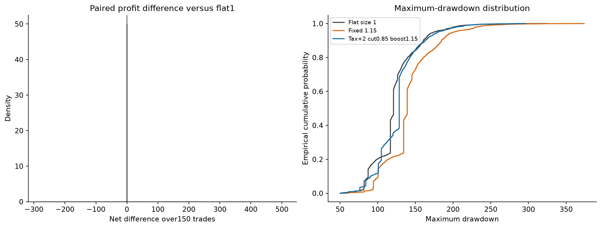
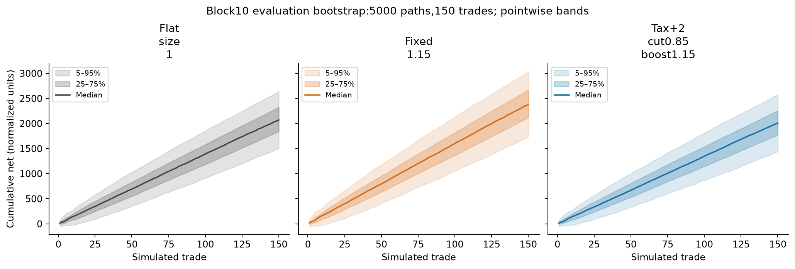
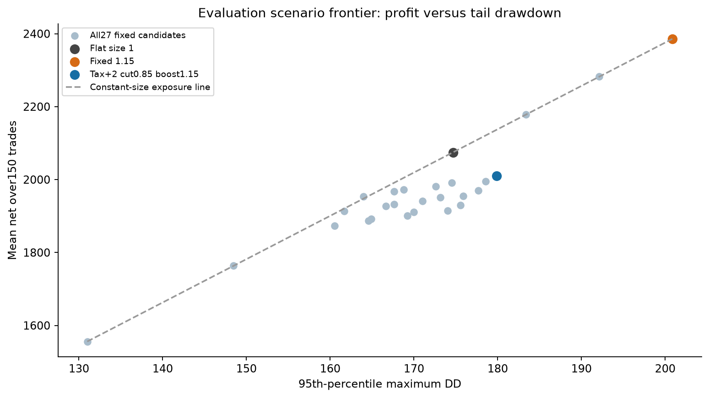
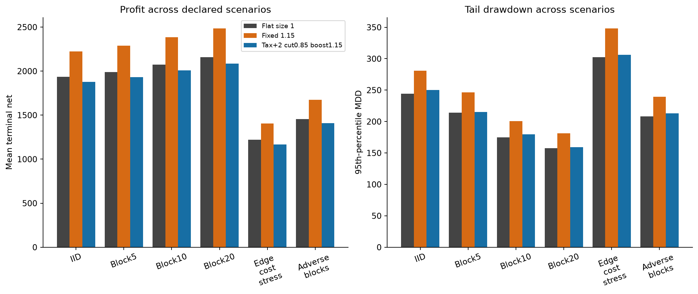

# Monte Carlo sizing scenarios

5000 paired paths ×150 trade opportunities; outcomes in normalized backtest units, not account returns.
Selection uses2022–2024; evaluation uses2025–2026. No future mean balancing. Previously researched years are not an untouched holdout.
Conditional on legacy fixed entries/fills and higher-tax training cache; Monte Carlo does not remove those limitations.

| Training-selected objective | Policy | Evaluation MC mean net | Net p05 | DD p95 | Mean size |
|---|---|---:|---:|---:|---:|
| Baseline | Flat size 1 | 2,074.62 | 1,509.13 | 174.66 | 1.0000 |
| Maximum simulated mean profit | Fixed 1.15 | 2,385.82 | 1,735.50 | 200.86 | 1.1500 |
| Maximum adaptive mean profit | Tax+2 cut0.85 boost1.15 | 2,010.41 | 1,444.10 | 179.88 | 0.9800 |
| Maximum mean profit at flat tail-DD budget | Flat size 1 | 2,074.62 | 1,509.13 | 174.66 | 1.0000 |

Full six-scenario and all27-policy comparisons: `monte_carlo_sizing.xlsx` and `mc_evaluation.csv`.
Maximum means maximum among this declared bounded policy grid, not the maximum attainable future profit.
Fixed1.15 is an exposure benchmark: it scales both profit and drawdown by15%; that alone is not allocation alpha.
Scenario p05/p95 bands are conditional empirical bootstrap ranges, not guarantees or comprehensive model uncertainty.
The drawdown budget is a flat1 training-tail reference, not a user-specified capital limit. No live policy adopted.

