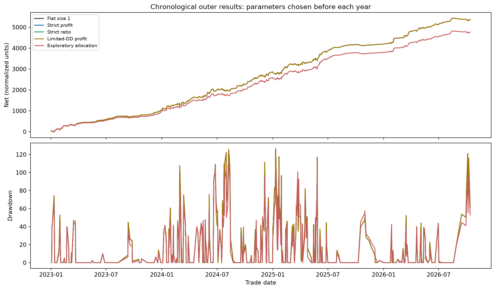
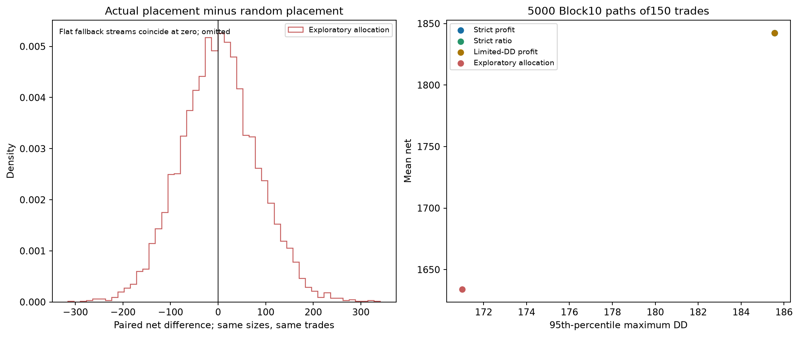
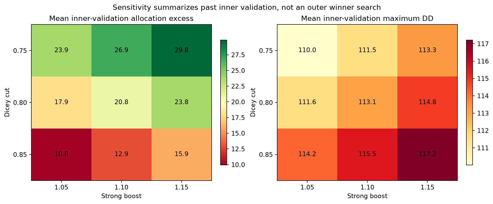

# Nested sizing and equal-exposure placement test

1944 fixed combinations; yearly past-only selection;442 outer2023+ trades. No normalization. Conditional legacy entry book, not an untouched holdout.
Random placements preserve exact sizes and size sums; they are diagnostic counterfactuals, not tradable risk-gated policies.

| Policy | Outer net | Max DD | Mean size | Placement excess vs random |
|---|---:|---:|---:|---:|
| Flat size 1 | 5,375.05 | 126.39 | 1.0000 | -0.00 |
| Strict profit | 5,375.05 | 126.39 | 1.0000 | -0.00 |
| Strict ratio | 5,375.05 | 126.39 | 1.0000 | -0.00 |
| Limited-DD profit | 5,375.05 | 126.39 | 1.0000 | -0.00 |
| Exploratory allocation | 4,770.88 | 114.43 | 0.8869 | +8.90 |

No future normalization or post-score grid winner. Strict policies fall back to flat when past validation fails.
Exploratory allocation is shown even when validation fails; it is not an adopted alpha model.
Permutation frequencies and bootstrap intervals condition on this historical sample and do not establish future profitability.

